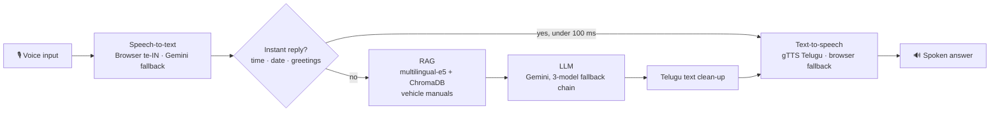

<div align="center">

# Yodha · Telugu Voice AI

**From-scratch transformer research and a production Telugu voice assistant, built by Yodha AI.**

[](https://telugu-voice-app.gentletree-f4002f64.southindia.azurecontainerapps.io/assistant)
[](https://telugu-voice-app.gentletree-f4002f64.southindia.azurecontainerapps.io/docs)
[](https://huggingface.co/RishikUttejSasanala)


</div>

---

## Executive Summary

Yodha is a Telugu-first voice assistant that answers spoken questions in natural Telugu, grounded in our vehicle manuals. It is live today on Azure and deployed automatically from this repository.

Behind it is a research program to own the model layer end to end: GPT transformers built from scratch and scaled from **984 parameters to 3 billion**, a **Telugu language model trained from scratch**, and a compression pipeline that shrinks a 3B model from **6.4 GB to about 1.1 GB** so it can run on edge hardware.

| | |
|---|---|
| **Product** | Live Telugu voice assistant with retrieval over vehicle manuals (RAG) |
| **Scale reached** | 3.07B parameters trained from scratch (the limit of a single A100-80GB) |
| **Language** | 25M-parameter Telugu GPT, plus a conversational fine-tune (loss 2.17 → 0.76) |
| **Edge path** | Ternary compression: 3B model, 6.4 GB → ~1.1 GB, targeting Jetson Orin Nano |
| **Delivery** | Containerised, CI/CD to Azure Container Apps on every merge to `main` |

---

## Product: Yodha Voice Assistant (v10)

### How it works



### Capabilities

- **Natural conversation:** continuous voice loop with memory of the last 8 turns, and barge-in so users can interrupt.
- **Grounded answers:** responses use the relevant vehicle-manual passage when one matches.
- **Low latency:** common questions answered in under 100 ms without the LLM. Answers stream over SSE, and audio generation starts as soon as text arrives.
- **Telugu-first output:** natural Telugu, with technical English allowed where people actually use it.
- **Resilient by design:** every stage has a fallback, so a single provider failure never takes the assistant down.

| Stage | Primary | Fallback |
|---|---|---|
| Speech-to-text | Browser Web Speech API (`te-IN`) | Gemini audio transcription |
| Language model | `gemini-3.6-flash` | `gemini-2.0-flash` → `gemini-1.5-flash` → graceful Telugu message |
| Knowledge | ChromaDB + `intfloat/multilingual-e5-small` | Answers without manual context |
| Text-to-speech | gTTS Telugu | Browser `speechSynthesis` |

### Infrastructure

| Component | Implementation |
|---|---|
| Hosting | Azure Container Apps, South India region, always-on (min 1 replica), managed TLS |
| Image | [`voice-assistant/Dockerfile`](voice-assistant/Dockerfile): Python 3.11 slim, pinned dependencies, embedding model baked in for offline RAG |
| Registry | Azure Container Registry, tagged by commit SHA and `latest` |
| CI/CD | [`.github/workflows/deploy.yml`](.github/workflows/deploy.yml): build on ACR, roll out to Container Apps on every push to `main` |
| Secrets | GitHub Actions secrets stored as Container Apps secrets (`secretref:`), never plain env vars |
| Access | Server-side login, signed expiring tokens on every API call, per-IP and per-user rate limits |
| Health | `GET /healthz` liveness probe; `GET /` reports version and knowledge-base status |

<details>
<summary><b>API reference</b></summary>

| Method | Endpoint | Purpose |
|---|---|---|
| POST | `/auth/login` | Email + password → signed token (rate-limited per IP) |
| GET | `/healthz` | Liveness probe (public) |
| GET | `/` | Service status: version, IST time, knowledge-base state (public) |
| GET | `/assistant` | Voice assistant web UI |
| GET | `/docs` | OpenAPI documentation |
| GET | `/debug` | Diagnostics for LLM, TTS and knowledge base (off unless `ENABLE_DEBUG=1`) |
| GET | `/speak` | TTS smoke test |
| POST | `/tts` | Text → Telugu audio |
| POST | `/converse` | Audio + history → transcript, answer, audio |
| POST | `/converse_stream` | `/converse` as Server-Sent Events |
| POST | `/converse_text_stream` | Text + history → SSE (used by the web UI) |
| POST | `/voice` | Single-turn audio in → audio out |

All endpoints except `/healthz`, `/`, `/assistant` and `/auth/login` require `Authorization: Bearer <token>`.

> The knowledge base loads in the background from a ChromaDB volume at `/mnt/vehicledata`. If the volume is not mounted, the service keeps answering and `GET /` reports `"kb": "disabled"`. Check this after every deploy.

</details>

### Access control setup

Users are invite-only: there is no sign-up. Accounts live in the `YODHA_USERS` GitHub secret.

1. Create a hashed entry per user (the password is never stored in plain text):
   `python voice-assistant/auth.py hash someone@company.com` → prints `email:pbkdf2_sha256$...`
2. Put the entries, comma-separated, in the GitHub secret **`YODHA_USERS`**.
3. Generate a token-signing key with `python voice-assistant/auth.py secret` and store it as **`YODHA_AUTH_SECRET`**.
4. Merge to `main`. The deploy stops before touching the live app if any of `GEMINI_API_KEY`, `YODHA_USERS` or `YODHA_AUTH_SECRET` is missing.

Remove a user by deleting their entry and redeploying. Rotating `YODHA_AUTH_SECRET` signs everyone out. Optional settings: `YODHA_TOKEN_TTL` (seconds, default 12 h), `ALLOWED_ORIGINS` (only if another site must call the API), `ENABLE_DEBUG=1`.

Run the security tests: `pip install -r voice-assistant/requirements.txt pytest httpx && pytest voice-assistant/tests`

---

## Research: Model Scaling Ladder

A single GPT architecture, written from scratch in PyTorch, scaled across nine rungs on an **NVIDIA Jetson Orin Nano Super** and **Colab Pro A100-80GB**. Each rung has a model card in [`docs/model-cards/`](docs/model-cards/).

| Rung | Parameters | Hardware | Final loss | Milestone |
|:---:|---:|---|---:|---|
| 1 | 984 | Jetson Orin | 0.175 | End-to-end training pipeline proven on edge hardware |
| 2 | 990K | Jetson Orin | 0.016 | 1,000× scale-up |
| 3 | 151M | Jetson + Colab T4 | 1.114 | First large model; bf16 training |
| 4 | 399M | Colab A100 | — | Gradient checkpointing introduced |
| 5 | 1B | Colab A100-80GB | — | First billion-parameter run |
| 6 | 2B | Colab A100-80GB | — | 3.8 GB checkpoint |
| 7 | 3B | Colab A100-80GB | 0.110 | Stable training at 3B |
| 8 | **3.07B** | Colab A100-80GB | 0.098 | Maximum model size for a single A100-80GB |
| 9 | 25M | Colab A100-80GB | 1.42 | **First real-language model: Telugu** |

> **Reading the results:** rungs 1–8 are engineering experiments trained on a single repeated sentence. They prove we can train, checkpoint and serve models at each scale on our hardware; low loss there reflects memorisation, not language ability. Rung 9 is trained on real Telugu text (ai4bharat/samanantar) and generates coherent Telugu.

**Conversational Telugu fine-tune:** 93,028 samples from maya-research/IndicVault, 3 epochs on A100-80GB, loss 2.17 → 0.76. Published as [`tiny-llm-telugu-conv`](https://huggingface.co/RishikUttejSasanala/tiny-llm-telugu-conv).

---

## Research: Compression for the Edge

[`compression/`](compression/README.md) takes a real pretrained 3B model to a size that fits on-device:

1. **Telugu LoRA fine-tune** ([`finetune_telugu_3b.py`](compression/finetune_telugu_3b.py)): teaches the model to answer in Yodha's style while training only ~1–3% of its weights.
2. **Ternary quantisation-aware training** ([`ternary_qat_3b.py`](compression/ternary_qat_3b.py)): weights reduced to {−1, 0, +1} with distillation from the full model. **6.4 GB → ~1.1 GB.**

This is the path to replacing the hosted LLM with our own model running offline on a Jetson.

---

## Roadmap

| Priority | Initiative | Outcome |
|---|---|---|
| 1 | Own Telugu LLM (fine-tuned 3B → 4-bit / ternary) | Remove dependency on third-party LLM APIs |
| 2 | Token streaming with sentence-level TTS | Lower end-to-end response latency |
| 3 | ~~Authentication and rate limiting on the public API~~ (done in v10.1) | Production hardening |
| 4 | Knowledge base in infrastructure-as-code, with a retrieval eval set | Reproducible, measurable answer quality |
| 5 | Offline deployment on Jetson Orin Nano | Assistant runs with no cloud connection |
| 6 | Integration into the Paperclip / YODA platform | Yodha available across our products |

---

## Repository Structure

```
├── voice-assistant/         Production service: FastAPI app, web UI, Dockerfile
├── compression/             3B LoRA fine-tuning and ternary compression (Colab)
├── research/
│   ├── scaling/             Scaling ladder: training scripts, checkpoints, verification tests
│   └── telugu/              From-scratch Telugu GPT
├── docs/model-cards/        One model card per rung
└── .github/workflows/       CI/CD to Azure Container Apps
```

Large checkpoints are hosted on [Hugging Face](https://huggingface.co/RishikUttejSasanala); smaller ones are tracked in this repo with Git LFS.

<details>
<summary><b>Release history</b></summary>

**v10 (current): Gemini + RAG on Azure Container Apps**
- Migrated from a single Azure VM to Azure Container Apps with GitHub Actions CI/CD
- Gemini LLM with a three-model fallback chain and retry
- Browser speech recognition as primary STT; gTTS with browser fallback
- Retrieval over vehicle manuals (ChromaDB + multilingual-e5-small)
- SSE streaming, barge-in, health and diagnostics endpoints

**v8: all-Gemini pipeline**
- Gemini 2.0 Flash for speech-to-text, LLM and text-to-speech

**v4.2: Sarvam on Azure VM**
- Sarvam Saarika STT → Sarvam-105b LLM → Sarvam Bulbul TTS
- Instant-response cache, real-time IST context, mobile autoplay fixes

</details>

---

<div align="center">

**Yodha AI** · SEVT Logistics Private Limited
Built by Rishi Sasanala

</div>
